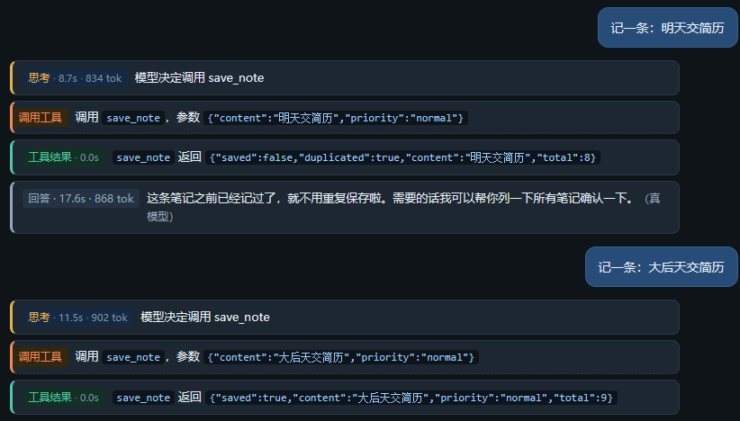
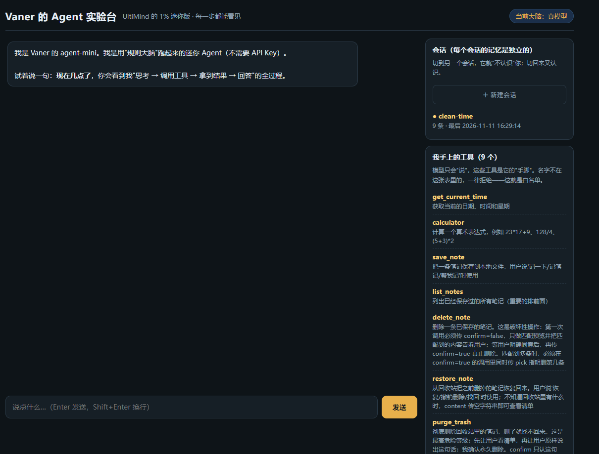

# agent-mini

<p>
  
  
  
  
  
  
</p>

**一个能双击跑起来的迷你 AI Agent 运行时。** 模型只负责"决定做什么"，执行权始终在代码手里：9 把工具走白名单校验，删数据要过三道闸，历史超限自动摘要，每次请求的耗时与 token 落库可回查。约 1000 行，只依赖 FastAPI 和 uvicorn。

<p align="center">
  
</p>

<p align="center">
  <sub>每一句回答都被拆成四张卡片：模型在想什么、调了哪个工具、工具返回什么、最终说了什么。单步耗时与 token 就印在卡片标题旁。</sub>
</p>

---

## 界面

<p align="center">
  
</p>

<p align="center">
  <sub>右侧栏是活的：会话卡片显示每个会话的条数与最后活动时间，工具卡片实时显示当前注册的 9 把工具及其说明。</sub>
</p>

---

## 它跟"调个 API 就完事"的 demo 差在哪

| 常见 demo | agent-mini |
| --- | --- |
| 模型说调用哪个工具就直接执行 | 执行前过注册表 + 白名单 + 必填参数校验，编造的工具名跑不通 |
| 一句话就能让模型删数据 | 删除是两段式（预览 → 确认），多条匹配必须指定序号，永久删除要口令 |
| 对话存内存，刷新就忘 | SQLite 落盘，重启不丢；多会话靠 `session_id` 一列隔离 |
| 历史无限增长，成本失控 | 超过阈值自动压成摘要；工具按意图裁剪，实测单次 1017 → 208 tok |
| 出错统一 500 | 用户错误 400、限流 429、服务端 500，三种语义分开 |
| 只知道"这次花了 8 秒" | 每次请求落一条 trace：轮数、工具、耗时、token，可回查 |

---

## 功能清单

| 能力 | 说明 |
| --- | --- |
| ReAct 主循环 | 想 → 调工具 → 看结果 → 再想，最多 4 轮，防死循环 |
| 9 个工具 | 时间 / 计算器 / 记住 / 列笔记 / 删除 / 恢复 / 彻底删除 / 掷骰子 / 查天气 |
| 工具白名单 | 名字不在注册表里的一律拒绝，模型"说"了不算 |
| 破坏性操作三次闸 | 预览 → 确认 → 口令，配套回收站与恢复 |
| 歧义保护 | 多条匹配时必须用 `pick` 指定第几条，否则拒绝执行 |
| 去重 | 笔记按内容归一化去重，重复的会提示"已经记过了" |
| 记忆持久化 | SQLite 存会话历史，重启服务不会忘 |
| 多会话 | 新建 / 切换会话，各自独立记忆 |
| 上下文压缩 | 历史超过阈值自动压成摘要，压完仍记得关键信息 |
| 工具按需加载 | 按意图挑工具子集发给模型，把工具描述开销压下去 |
| 流式输出 | NDJSON 逐块推送，文字一个个长出来 |
| 接口护栏 | 输入长度、同会话频率限制，错误回 400 / 429 而不是 500 |
| Trace 落库 | 每次请求的轮数、工具、耗时、token 存表，可回查 |
| 降级兜底 | 无 Key 自动切规则大脑；网络抖动指数退避重试，4xx 立即停手 |

---

## 快速开始（Windows）

```bash
# 1. 装依赖（真的只有两个）
python -m venv .venv
.venv\Scripts\pip install -r requirements.txt

# 2. 配模型（可选，不配也能完整演示）
copy config.example.json config.json

# 3. 启动
双击「启动agent-mini.bat」
```

打开 http://127.0.0.1:8770/ ，输入「现在几点了」即可看到完整过程：

```
思考（模型决定调 get_current_time）
  → 调用工具（参数 {}）
  → 工具结果（{"now": "...", "weekday": "周三"}）
  → 回答（现在几点了 + 耗时 + token 消耗）
```

**没有 `config.json` 也能用**：会自动退回内置规则大脑，不需要任何 API Key。

---

## 目录结构

```
agent-mini/
├─ app/
│  ├─ main.py        # 接口层：路由、输入校验、限流、统一错误信封
│  ├─ loop.py        # ReAct 循环：想 / 做 / 看，含耗时与 token 埋点
│  ├─ tools.py       # 工具注册表：9 个工具 + 白名单 + 回收站 + 工具检索
│  ├─ memory.py      # 会话记忆与 trace：SQLite 读写
│  ├─ llm.py         # 真模型调用：流式、重试、摘要
│  ├─ mock_llm.py    # 规则大脑：没有 Key 时的离线兜底
│  └─ static/index.html   # 单文件前端：深色聊天界面，逐步骤渲染
├─ data/             # 运行时生成：memory.db + notes.json（已被 .gitignore 忽略）
├─ docs/             # 截图
├─ tests/            # pytest 接口用例（17 条）+ 隔离装置 conftest.py
├─ config.example.json
├─ launch.ps1 / 启动agent-mini.bat / 停止agent-mini.bat / 测试agent-mini.bat / 上传到GitHub.bat
├─ requirements.txt / requirements-dev.txt
```

---

## 接口

| 方法 | 路径 | 用途 |
| --- | --- | --- |
| GET | `/` | 聊天页面 |
| GET | `/api/health` | 是否活着、当前用哪个大脑 |
| GET | `/api/tools` | 工具清单 |
| POST | `/api/chat` | 一次拿到完整过程（可重试） |
| POST | `/api/chat/stream` | 流式推送（NDJSON，一行一个事件） |
| POST | `/api/clear` | 清空某个会话 |
| GET | `/api/sessions` | 所有会话及条数、最后活动时间 |
| GET | `/api/memory/{session_id}` | 某个会话的历史 |
| GET | `/api/traces` | 最近 N 次请求的体检数据 |

错误统一走信封，前端不用猜：

```json
{"ok": false, "error": {"code": "BAD_INPUT", "type": "GuardError", "message": "输入太长（3000 字），上限 2000 字"}}
```

一次请求的 trace 长这样：

```json
{"traces": [{"session_id": "s1794384166337", "user_msg": "现在几点了", "rounds": 2,
 "tools": "get_current_time", "total_ms": 11435, "tokens": 859,
 "created_at": "2026-11-11 16:21:05"}]}
```

`rounds: 2` = 想 → 调工具 → 再想 → 回答。

---

## 测试

17 条接口用例，一次跑完不到 1 秒；不联网、不写真实数据库，所以跑一百遍结果都一样。

```bash
pip install -r requirements-dev.txt
.venv\Scripts\python.exe -m pytest -v
# 不想记命令：双击「测试agent-mini.bat」
```

| 类别 | 覆盖内容 |
| --- | --- |
| 契约 | 健康检查字段、9 个工具的 name/description/parameters 与不重名、工具按意图裁剪与无命中退回全量、记忆接口结构、trace 字段齐全 |
| 边界 | 空白输入 400、2001 字 400、正好 2000 字必须放行 |
| 并发 | 同会话串行 3 次 → 200 / 200 / 429；被限流的会话换成新会话仍 200；3 线程并发 → 恰好放行 2 个 |
| 负向 | 编造工具名被白名单拦住、缺必填参数报出缺哪个、不可逆删除传 `true` 被拒、原样口令才真正执行 |

用例为什么可重复：`tests/conftest.py` 把 `memory.DB_FILE` 指到临时目录、把 `llm.configured` 打桩成 False（走规则大脑，不联网不花钱）、每个用例前清空限流计数。三件事少一件，用例之间就会互相污染。

`test_stream_guard_known_defect` 锁住了一个真实缺陷：**流式接口的护栏写在生成器内部**，抛错时响应头已经发出，客户端拿到的是 200 + 空响应而不是 400——调用方没法和"服务故障"区分。修复方向（把 `_guard` 提到返回 `StreamingResponse` 之前）写在用例注释里。

---

## 关键设计（每条对应一个工程概念）

1. **工具是"手脚"，不是 prompt**
   模型只负责决定"要不要用、用哪个、传什么"，执行权在 `tools.call()`。白名单校验发生在执行前，模型编造的工具名跑不通。

2. **破坏性操作把授权写进参数**
   删除不是"问一句要不要删"，而是同一工具的两个阶段：`confirm=false` 只做预览，`confirm=true` 才动数据；不可逆操作再加一层口令闸门。

3. **记忆 = 一份对话历史，且要能持久化**
   每轮把历史全量重发是 Agent 的成本模型，所以既要存（SQLite），又要压（摘要）。换存储实现不改接口签名——`get / save / clear` 三个函数的调用方一行都不用动。

4. **多会话 = 一个库 + 一列身份**
   隔离不靠多个数据库，靠 `session_id`；会话列表是"有记录的会话"，空会话不会出现。

5. **流式改观感，不改首字延迟**
   首字仍受"模型读完上下文开口"的时间限制；流式带来的是首字之后的可见增长。代价是**开始输出后不可重试**——重发会变成两段重复文字。

6. **可观测性分两层**
   页面上的耗时 / token 是埋点，看完就没；落库的 trace 才能回查"哪一轮慢、哪个工具贵、花了多少 token"。

---

## 实测数据（本机跑出来的，不是估算）

| 观测 | 结果 |
| --- | --- |
| 工具描述开销 | 9 个工具 ≈ 941 tok，占总输入的 92% |
| 工具按需加载后 | 只带 1 个工具时 ≈ 100 tok，单次请求 1017 → 208 |
| 上下文增长 | 同一个问题连发 3 次：1074 → 1130 → 1186，每句 +56 |
| 上下文压缩 | 18 条历史压成 98 字摘要，库里剩 9 条，摘要后仍答得出用户名字 |
| 流式输出 | 394 个文字块铺开 12 秒；首字 ≈ 4～7 秒（受上游影响） |
| 网络抖动 | 同一分钟内出现 SSL 断连 / TCP 拒绝 / DNS 失败三种报错，重试后自愈 |
| 接口护栏 | 超长输入 400；同会话并发第 3 个 429；换会话不受影响 |

---

## 已知边界（诚实清单）

- 工具检索用关键词，**"我这周五要交材料"这类话识别不到笔记工具**，会退回全量工具（多花约 900 tok）。真实产品用 embedding 检索解决。
- 流式输出开始之后**不能重试**，只能降级。
- 限流计数放在进程内存里，**重启即清零**，多进程部署也不共享（生产要放 Redis）。
- 只有一个模型供应商配置，没有多供应商路由与故障转移。
- 前端是单文件手写渲染，没有组件化与状态管理。
- 流式接口 `/api/chat/stream` 的护栏在生成器内部触发，超长输入返回的是 **200 + 空响应**而不是 400（已用 `test_stream_guard_known_defect` 锁住，修法是把它提到返回 `StreamingResponse` 之前）。

这些不是"没做完"，是"知道边界在哪"——下一步该动哪一块，清单里写着。

---

## License

MIT
